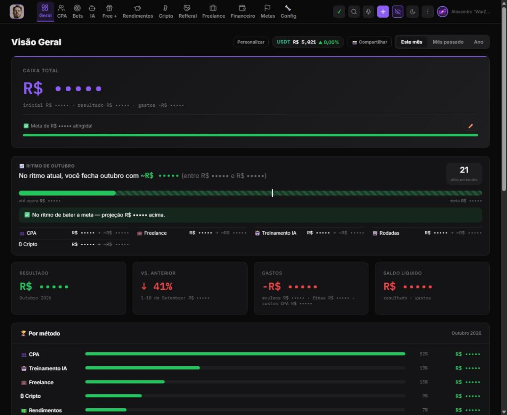
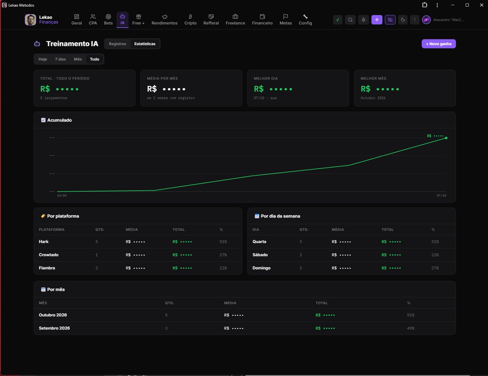
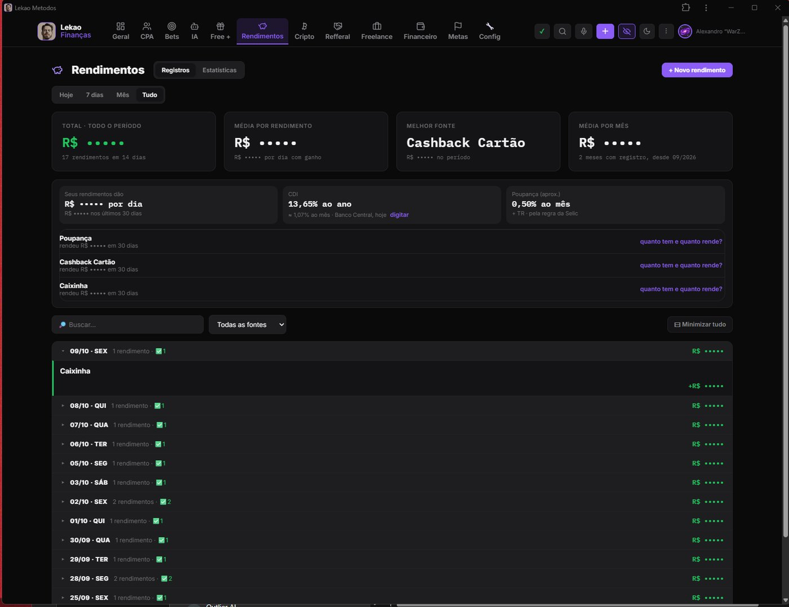
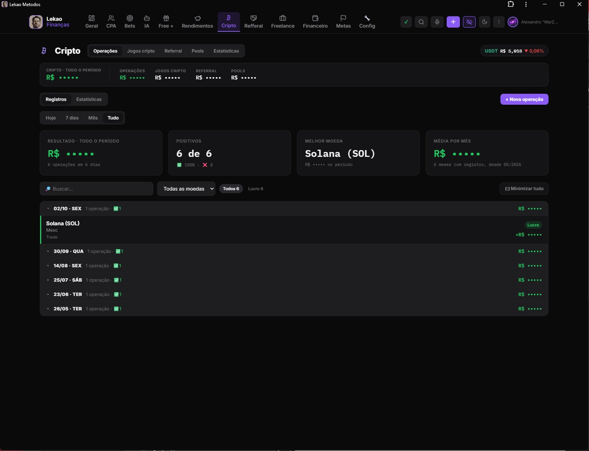
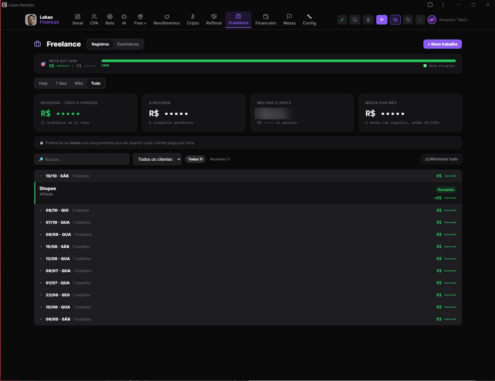
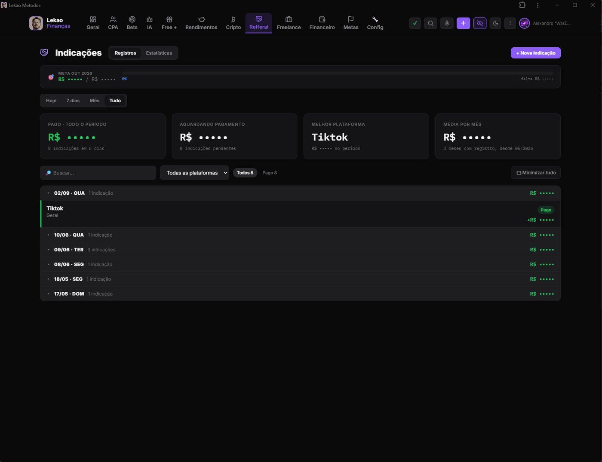

<p align="center">
  
</p>

<h1 align="center">Lekao Finance</h1>

<p align="center">
  A mobile-first personal finance & income tracker (PWA), plus a Python data pipeline that feeds it.
  <br>
  <b>JavaScript · Firebase (Hosting, Firestore, Auth, Cloud Messaging) · Python · Playwright</b>
</p>

---

## Overview

I work with several online income streams at once: freelance and AI training tasks, crypto, affiliate programs, referrals and investments. Spreadsheets stopped being enough, so I built my own app to track all of them in one place, on both phone and PC.

Lekao Finance is an installable **Progressive Web App**: it works offline, syncs to the cloud with Google sign-in, and sends push notifications. It is written in **plain HTML, CSS and JavaScript with no framework or build step**.

## App features

- **Dashboard:** total cash, month result vs. previous month, expenses, net balance, per-source breakdown and an **end-of-month projection** based on the current pace
- **One tab per income source:** freelance, AI training, crypto, affiliate/CPA, referrals, investments and more. Each one has its own records, monthly goal with progress bar, and a statistics view filterable by today / 7 days / month / all time
- **AI training stats:** earnings per platform, per weekday and per month, plus a cumulative earnings chart
- **Investments:** tracks yields per source and shows today's **CDI rate** and the savings-account rate for comparison
- **Crypto:** trades, crypto games, referral programs and liquidity pools in one place, with a live **USDT/BRL** quote
- **Freelance:** income per client, best client, pending payments and hourly rate when hours are logged
- **Central calculation layer:** every number in the app comes from a single module, so all tabs always agree
- **Finances:** fixed bills, expenses, net worth and a yearly income-tax (IRPF) helper
- **AI-assisted import:** upload a screenshot and the **Claude API** extracts the entries automatically
- **Voice input** for quick entries
- **Custom tabs** created by the user: notes, checklists, goals
- **Team mode:** invite a partner by e-mail with access limited to shared data only, enforced by Firestore security rules
- **Security:** locked vault area, daily automatic cloud backups, CSV export and reports
- **Privacy mode:** one tap hides every money value on screen (like banking apps), useful for sharing screenshots
- **Push notifications** through Firebase Cloud Messaging
- Dark and light themes, responsive layout down to 360px

## Data pipeline (Python)

A companion Python tool collects and maintains a catalog of affiliate partner sites and publishes it to the app.

- Discovers new sites from **public sources only**: Certificate Transparency logs (crt.sh), RDAP domain registration data, urlscan.io and newly registered domain lists
- Reads public pages with **Playwright** (headless Chromium) and `requests`, groups mirror domains by a shared site ID, and tracks changes over time
- Health tracking per pipeline stage to detect when a step breaks, with clear rules for marking a site as down (2 consecutive failures) vs. uncertain (rate limits, Cloudflare)
- Polite crawling: limited parallelism per operator, pauses and fast back-off when a service is unavailable
- Uploads results to Firestore with a service account and sends push alerts when something important changes
- Can run on a schedule with Windows Task Scheduler (PowerShell setup script)

## Architecture

```
 ┌──────────────────────┐        ┌──────────────────────────────┐
 │  Python pipeline     │        │  Firebase                    │
 │  Playwright, requests│ ─────► │  Firestore (catalog + user   │
 │  crt.sh, RDAP,       │ write  │  data), Auth, Cloud Messaging│
 │  urlscan             │        └───────────────┬──────────────┘
 └──────────────────────┘                        │ read/write (rules per user)
                                                 ▼
                                   ┌──────────────────────────────┐
                                   │  PWA (vanilla JS)            │
                                   │  Service worker, offline,    │
                                   │  Claude API import, push     │
                                   └──────────────────────────────┘
```

- User data lives in `users/{uid}/...`; security rules allow access to the owner only
- Large data sets are split into chunks automatically to stay under Firestore's 1 MB document limit
- Versioned service-worker cache so phones always get the latest release
- Automated UI tests with Playwright on desktop (1440×900) and mobile (392×850) viewports

## Screenshots

*All screenshots were taken with the built-in privacy mode on, which hides money values.*

**Dashboard**



| AI training: statistics | Investments |
|---|---|
|  |  |

| Crypto | Freelance |
|---|---|
|  |  |

**Referrals**



## Tech stack

| Area | Tools |
|---|---|
| Front end | HTML, CSS, vanilla JavaScript, PWA (service worker, manifest) |
| Back end | Firebase Hosting, Firestore, Firebase Auth (Google), Cloud Messaging |
| AI | Claude API (screenshot data extraction) |
| Data pipeline | Python, Playwright, requests, google-cloud-firestore, PostgreSQL client |
| Testing | Playwright |

## Source code

The source code is kept private. **Available upon request** for recruiters and technical reviewers.

## Author

**Alexandro Rodrigues** · IT professional & Python developer · Rio de Janeiro, Brazil
[LinkedIn](https://www.linkedin.com/in/alexandro-rodrigues-07802292/)
